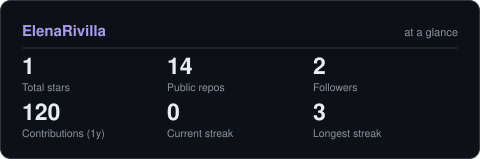

<!-- BANNER - terminal profile.sh --live (additive). Generated by scripts/banner/generate.py.
     ~0.7–0.8 MB each. Cache-bust with ?v=N after regenerating. -->
<picture>
  <source media="(prefers-color-scheme: dark)"  srcset="assets/banner-dark.v9.svg">
  <source media="(prefers-color-scheme: light)" srcset="assets/banner-light.v9.svg">
  
</picture>

 

<!-- NAME / TAGLINE - animated typing -->

 

<!-- SOCIALS — LinkedIn stays brand blue (glyph vanishes on custom fills). -->

 

---

## This is me :)

Hi, I'm **Elena**, full stack web developer and tech manager, broadcasting from
Islas Baleares, España 🇪🇸.
I work across the whole stack, from backend systems to the infra that keeps them running,
and I care about building things that are solid, maintainable, and actually work in production.

- 💼 **Web Developer & Tech Manager at [Travelance](https://travelance.com)**: leading development and managing the technical side of our products.
- 🛠️ **Full stack**, comfortable end to end: from C# / .NET APIs to Angular frontends, with the infra and tooling to ship and monitor it all.
- ☁️ Working daily with **cloud & DevOps**: Docker, OpenShift, Azure DevOps, and observability with Dynatrace.
- 🤖 Exploring **AI-assisted development** with Claude Code and Copilot as part of the daily workflow.
- 💬 Talk to me about **.NET, Angular, or how to keep a tech team shipping without breaking things**, and you'll have my full attention.
 

## my perfect stack

---

## signals 

<table>
<tr>
<td width="50%" align="center" valign="middle">

<!-- Self-rated radar - edit assets/skills.json, the workflow redraws it -->
<picture>
  <source media="(prefers-color-scheme: dark)"  srcset="assets/radar-dark.svg">
  <source media="(prefers-color-scheme: light)" srcset="assets/radar-light.svg">
  
</picture>

</td>
<td width="50%" align="center" valign="middle">

<!-- Hand-authored contract & language stack radar - edit assets/langmix.json -->
<picture>
  <source media="(prefers-color-scheme: dark)"  srcset="assets/radar-langs-dark.svg">
  <source media="(prefers-color-scheme: light)" srcset="assets/radar-langs-light.svg">
  
</picture>

</td>
</tr>
</table>

---

## Numbers matter? ohhh yes. 

<!-- Generated by scripts/cards.py into this repo. Deliberately NOT
     github-readme-stats / streak-stats / github-profile-trophy: those are
     shared public instances that go down and take the whole section with them. -->
<picture>
  <source media="(prefers-color-scheme: dark)"  srcset="assets/card-stats-dark.svg">
  <source media="(prefers-color-scheme: light)" srcset="assets/card-stats-light.svg">
  
</picture>

 

---

` Build with love · Elena Rivilla `

